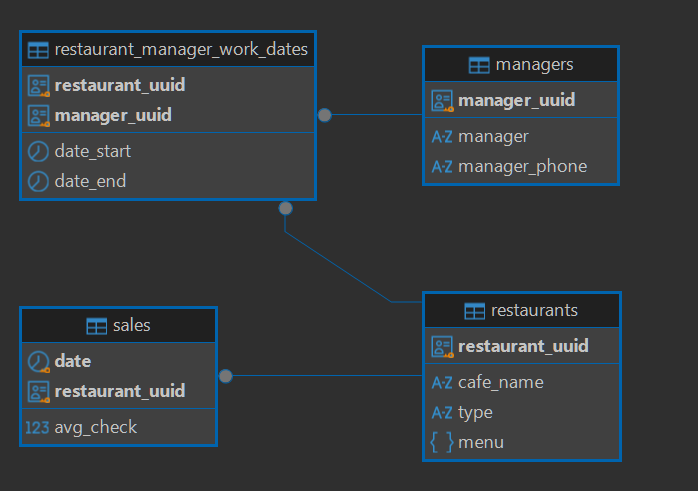

# Проектирование БД, миграция данных и аналитические витрины (PostgreSQL)

Кейс по переводу разрозненных сырых данных сети заведений общественного питания (рестораны, бары, пиццерии, кофейни) в нормализованную реляционную базу данных PostgreSQL с построением витрин отчетности и настройкой безопасных транзакционных обновлений.

## Бизнес-задача
Сеть заведений столкнулась с проблемой хранения данных о продажах, меню и персонале в неструктурированных выгрузках. Требовалось:
1. Спроектировать единую масштабируемую архитектуру БД (3НФ + полуструктурированные данные в `JSONB`).
2. Настроить перенос и дедупликацию исторических данных из сырого слоя (`raw_data`).
3. Создать аналитические витрины для оценки динамики среднего чека, эффективности точек и анализа ассортимента.
4. Реализовать безопасные скрипты массового обновления цен и контактов без блокировки чтения для пользователей и аналитиков.

## Стек технологий
* **СУБД:** PostgreSQL
* **Инструменты и фичи:** PL/pgSQL, `JSONB` (JSONPath, `jsonb_each_text`, `jsonb_set`), оконные функции (`ROW_NUMBER`, `RANK`, `DENSE_RANK`, `LAG`), `MATERIALIZED VIEW`, управление уровнями изоляции и блокировками (`FOR UPDATE`, `SHARE UPDATE EXCLUSIVE MODE`).

## Архитектура проекта
* `sql/01_ddl_schema.sql` — создание схемы `cafe`, пользовательских типов (`ENUM`), таблиц фактов и измерений с настройкой первичных и внешних ключей.
* `sql/02_etl_migration.sql` — ETL-скрипты очистки, дедупликации (`DISTINCT ON`) и загрузки данных из сырого слоя в целевые таблицы.
* `sql/03_analytics_views.sql` — представления (`VIEW` и `MATERIALIZED VIEW`) для расчета топ-заведений по среднему чеку и годовой динамики выручки (YoY).
* `sql/04_analytics_queries.sql` — аналитические запросы: оценка текучести менеджеров и глубокий парсинг меню в формате `JSONB` (ассортимент, ценовые максимумы).
* `sql/05_safe_updates_transactions.sql` — транзакционные скрипты для индексации цен в `JSONB` и миграции телефонных номеров в формат массива `text[]` с точечной блокировкой строк/таблиц.

