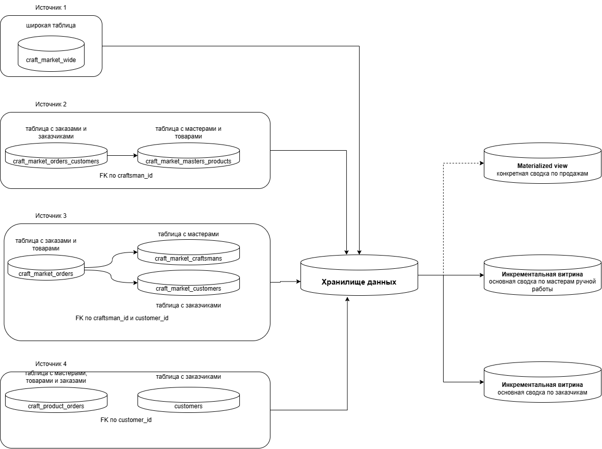

# Интеграция источников данных в DWH и инкрементальные витрины для маркетплейса

Проектирование и реализация хранилища данных (DWH) для маркетплейса товаров ручной работы: объединение данных из 4 разнородных источников (включая базу приобретенного внешнего сервиса) и настройка инкрементального обновления аналитических витрин.

## Бизнес-задача
Маркетплейс расширил аудиторию за счет покупки сторонней площадки. Данные о заказах, товарах, мастерах и покупателях хранились в 4 разных базах с разной структурой. Требовалось:
1. Объединить данные из всех источников в единое хранилище (модель «Звезда»: таблица фактов и таблицы измерений).
2. Настроить регулярную **инкрементальную загрузку** (обработка только новых и измененных записей) для экономии вычислительных ресурсов сервера.
3. Построить витрину аналитики по покупателям для запуска программы лояльности, расчета LTV и персонализации акций.

## Стек технологий
* **СУБД:** PostgreSQL
* **Подходы и инструменты:** DWH (модель «Звезда»), инкрементальный ETL (CDC по `load_dttm`, `CTE` с `INSERT` + `UPDATE`), оконные функции (`RANK`, `FIRST_VALUE`), расчет медиан (`PERCENTILE_CONT`), `MATERIALIZED VIEW`.

## Как устроен пайплайн
1. **Сбор и нормализация (Staging -> DWH):** данные из 4 источников очищаются, дедуплицируются и раскладываются по таблицам измерений (`d_customer`, `d_craftsman`, `d_product`) и фактов (`f_order`).
2. **Определение дельты изменений:** скрипт проверяет дату последней успешной загрузки в служебной таблице `load_dates_*` и забирает из DWH только новые или обновленные заказы и профили.
3. **Инкрементальное обновление витрин:**
   * Для новых клиентов/мастеров выполняется пакетная вставка (`INSERT`).
   * Для существующих — пересчитываются метрики за отчетный период и обновляются записи (`UPDATE`).
   * Фиксируется новая метка времени загрузки (`load_dttm`).

## Ключевые метрики в витринах
* Выручка по клиентам/мастерам и комиссия платформы (10%).
* Количество заказов в разрезе статусов (`created`, `in progress`, `delivery`, `done`, `not_done`).
* Средний чек и медианное время выполнения заказа в днях.
* Топ-категория товаров и предпочитаемый мастер для каждого покупателя.

